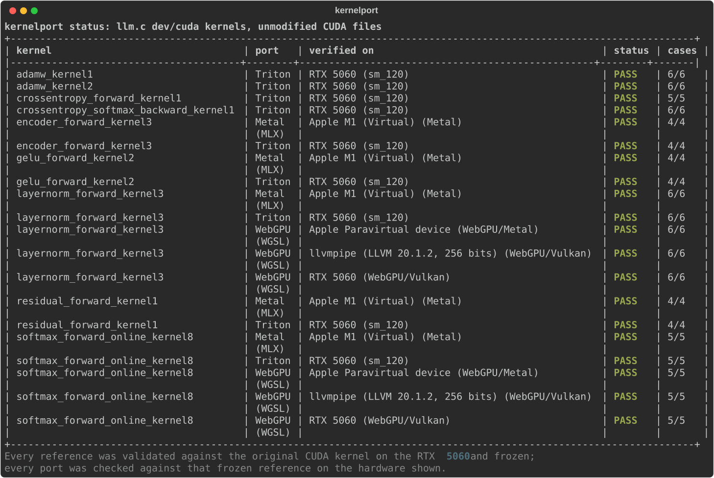

# Example: llm.c's CUDA kernels on Triton and Metal

Nine kernels from [karpathy/llm.c](https://github.com/karpathy/llm.c) `dev/cuda/`, ported and
verified with kernelport. The CUDA files here are **unmodified** copies of llm.c at commit
[`f1e2ace`](https://github.com/karpathy/llm.c/tree/f1e2ace651495b74ae22d45d1723443fd00ecd3a/dev/cuda)
(MIT, see [LICENSE](LICENSE)). They mix kernels with host code (`main()`, cuBLAS handles,
`<<<...>>>` launches, `#include <stdio.h>`); kernelport compiles only their device code with NVRTC.

`.kernelport/` is the workspace an agent produces, committed so the results travel with the repo:
the analyzer snapshot of all 27 kernels, the references and input specs for nine of them (frozen
after validation against the original CUDA kernels), the ports, and the results.



| kernel | what it uses | reference vs original CUDA | Triton (RTX 5060 Laptop) | Metal (Apple M1, CI) |
|---|---|---|---|---|
| `layernorm_forward_kernel3` | cooperative groups, warp reduce, 3 outputs | PASS 6/6 | PASS 6/6, 1.00x | PASS 6/6 |
| `gelu_forward_kernel2` | bf16, `Packed128` 128-bit loads | PASS 4/4 | PASS 4/4, 1.00x | PASS 4/4 |
| `residual_forward_kernel1` | bf16 | PASS 4/4 | PASS 4/4, 1.4x | PASS 4/4 |
| `encoder_forward_kernel3` | bf16 gather by token id, `Packed128` | PASS 4/4 | PASS 4/4, 0.9-1.8x (25 µs kernel, varies between sessions) | PASS 4/4 |
| `softmax_forward_online_kernel8` | online softmax, warp shuffles | PASS 5/5 (C >= 256, see below) | PASS 5/5, 1.0x | PASS 5/5 |

**Ported by a fresh agent.** These four were done by a coding agent with no prior context,
given only "port the CUDA kernels in this repo to Triton and verify them" and kernelport's
guide. Every Triton port passed on its first verification; the agent's one failed
validation (adamw: float32 scalars) led to a kernelport fix, see PROGRESS.md.

| kernel | reference vs original CUDA | Triton (RTX 5060 Laptop) |
|---|---|---|
| `adamw_kernel1` | PASS 6/6 | PASS 6/6, ~1.3x |
| `adamw_kernel2` | PASS 6/6 | PASS 6/6, 1.27x |
| `crossentropy_forward_kernel1` | PASS 5/5 | PASS 5/5 (few-µs kernel, timing too noisy to quote) |
| `crossentropy_softmax_backward_kernel1` | PASS 6/6 | PASS 6/6, 0.97x |

Speedups are the port vs the original CUDA kernel on the spec's largest case (GPT-2 sizes), same
GPU, device-event timing. The Metal column is checked by CI on every push on GitHub's macOS arm64
runner ("Apple M1 (Virtual)"): the Metal ports are verified against the references frozen on the
NVIDIA machine, without any CUDA there. All five passed on their first run.

## What validation found in llm.c

`softmax_forward_online_kernel8` maps one **warp** per row but returns early when
`threadIdx.x >= C`. When a row has fewer columns than the block has threads (256 here), whole
warps exit and their rows are never written. Validation against a plain `torch.softmax`
reference failed with "unexpected NaN ... the element was never written" from row 1 on; probing
the boundary gave C = 31, 32, 255 FAIL and C = 256, 257 PASS. llm.c calls this kernel with large C
(sequence length or vocabulary), so it does not hit the bug, but the precondition
`C >= blockDim.x` is not written down anywhere. The frozen spec only uses C >= 256, the range
where the original is correct; the ports have no such limit.

The `Packed128` kernels have a precondition too: each thread moves 8 bf16 values with no
per-element bounds check, so N (gelu) and C (encoder) must be multiples of 8. Their specs only
use such sizes.

## The loss head as a pipeline

`.kernelport/pipelines/gpt2_loss_head.json` chains three of these kernels the way GPT-2 training
runs them: logits -> `softmax_forward_online_kernel8` -> `crossentropy_forward_kernel1` (loss per
token) -> `crossentropy_softmax_backward_kernel1` (into a zeroed `dlogits`, dloss = 1/32). Each
stage is checked on what the stage before really wrote. That matters for crossentropy: its own
cases draw probabilities from [0.001, 1], while real softmax output is near 1/V (2e-5 at
V = 50257). Five cases, up to B=4, T=64, V=50257:

| chain | result |
|---|---|
| Triton ports (RTX 5060 Laptop) | PASS 5/5, every stage |
| original CUDA kernels (RTX 5060 Laptop) | PASS 5/5, every stage |

The float64 chain of references ends within 0.08x of one kernel's float32 tolerance on every
buffer. One case, `confident_2x8x1024` (logits with std 30), shows an fp32 effect that per-kernel
tests never see: softmax probabilities underflow to exactly 0, so a few losses are inf where
float64 gives a large finite value. The original kernels do this too (8 of 16 losses; the Triton
ports 5, as `__expf` and `exp` underflow at slightly different points). It is reported as drift,
not as a failure.

```bash
kernelport pipeline gpt2_loss_head --backend triton   # the ports
kernelport pipeline gpt2_loss_head --backend cuda     # the originals
```

## Reproduce

```bash
cd examples/llm.c
kernelport status                    # what is frozen, ported, verified where
kernelport verify --backend triton   # NVIDIA: re-verify the Triton ports
kernelport verify --backend metal    # Apple Silicon: verify the Metal ports
kernelport validate --all            # NVIDIA: re-validate any edited reference
```

Each kernel's files are in `.kernelport/kernels/<kernel>/`: `reference.py` and `launch.json`
(candidate), `frozen/` (validated copy + sha256 manifest), `ports/<backend>/port.py`,
`ports/<backend>/results/<hardware>.json`, and `attempts.jsonl` (every verification, including
the failed ones).
